<p align="center">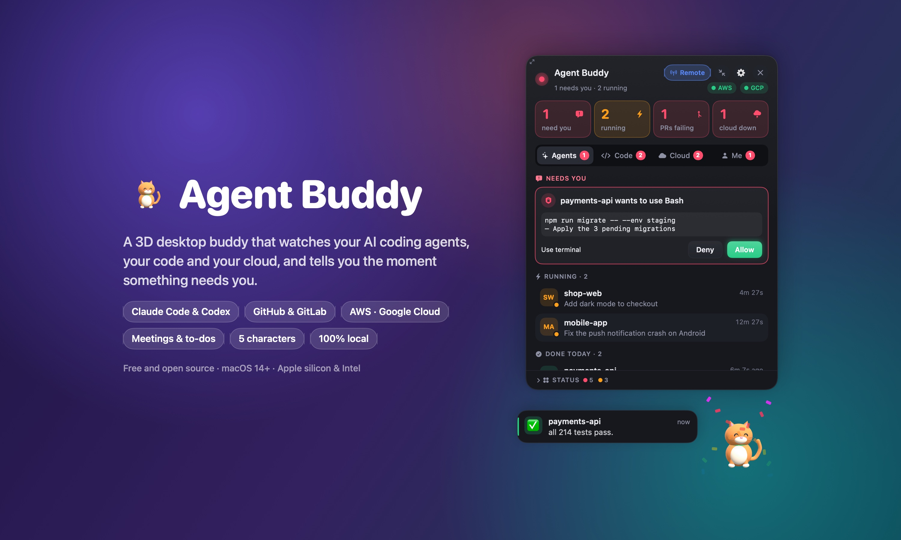</p>

<h1 align="center">Agent Buddy</h1>

<p align="center"><b>A 3D desktop buddy for your Mac that watches your AI coding agents, your code and your cloud,<br>and tells you the moment something needs you.</b></p>

<p align="center">
  <a href="https://github.com/aswinikumar-555/agent-buddy/releases/latest"></a>
  <a href="#install-on-your-mac"></a>
</p>

<p align="center">
  <a href="https://github.com/aswinikumar-555/agent-buddy/actions/workflows/build.yml"></a>
  <a href="https://github.com/aswinikumar-555/agent-buddy/releases/latest"></a>
  
  <a href="LICENSE"></a>
  <a href="https://github.com/aswinikumar-555/agent-buddy/stargazers"></a>
</p>

You start Claude Code or Codex on a few tasks, switch to something else, and lose track. Agent Buddy sits in the corner of your screen as a small 3D character (a cat, robot, rubber duck, owl or astronaut), keeps an eye on everything, and acts it out: it types while agents work, raises a paw when one needs you, and jumps when a task is done. Click it for the full picture.

Everything runs on your Mac. No account, no server, no tracking.

<p align="center">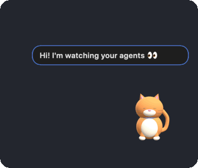</p>

**[Download the app](https://github.com/aswinikumar-555/agent-buddy/releases/latest)** (no developer tools needed), or build it yourself:

```bash
git clone https://github.com/aswinikumar-555/agent-buddy.git ~/agent-buddy && cd ~/agent-buddy && bash install.sh
```

That's the whole install ([details](#install-on-your-mac)). Building takes about a minute.

<p align="center">
  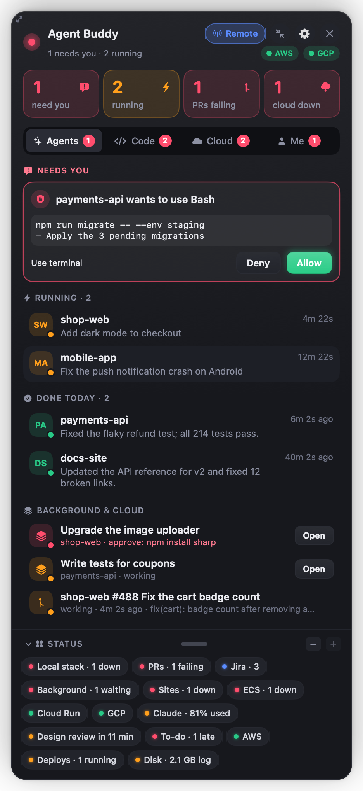
  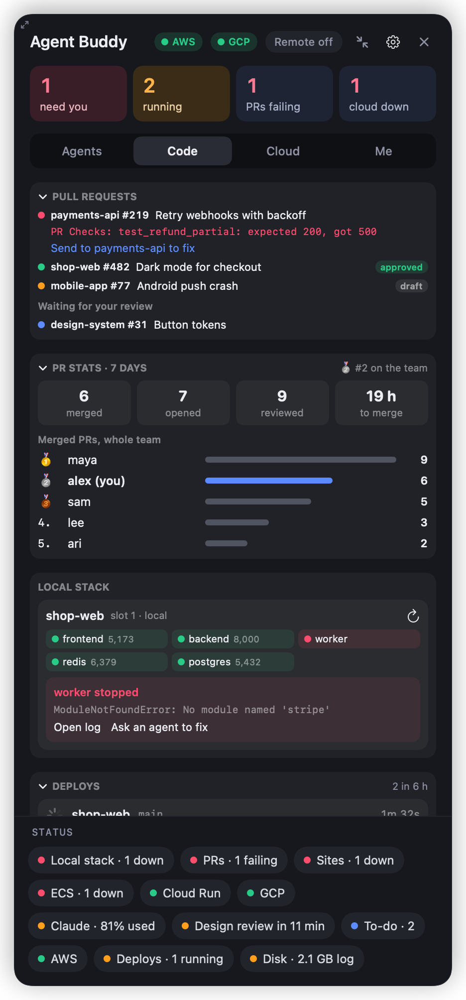
  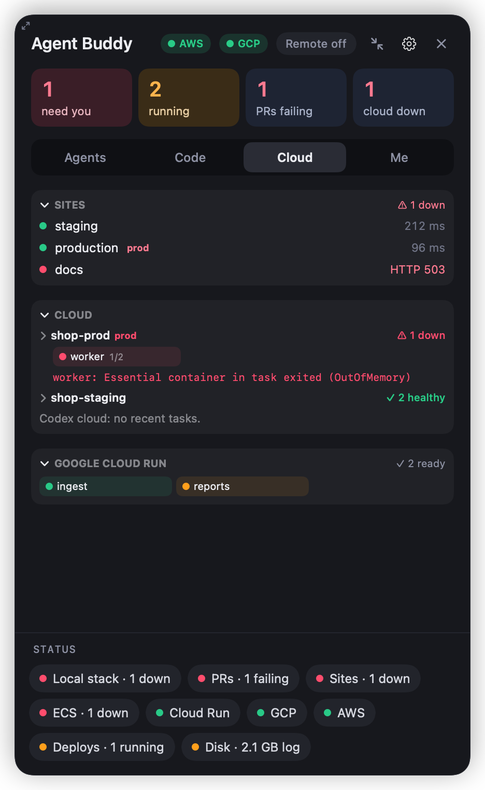
</p>
<p align="center"><sub>Click the buddy to open the panel: <b>Agents</b>, <b>Code</b>, <b>Cloud</b> and <b>Me</b> tabs, with status pills at the bottom.</sub></p>

---

## What it does

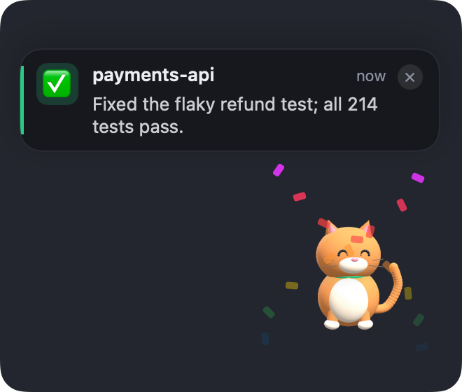

**Your agents (Claude Code and Codex)**
- Shows which agents are running, which need you, and what each one finished, in the agent's own words ("Fixed the flaky refund test; all 214 tests pass").
- Click a bubble to jump straight to that agent's terminal.
- **Remote mode:** approve permission prompts, answer an agent's questions, and reply when it finishes, all from the buddy. It can switch on by itself when you step away.
- **Chat:** send a message to any agent from the buddy, whether it's working or idle.
- **`buddy say "…"`:** any agent or script can put a message on your screen.
- **Codex too:** its chat history, messages from the buddy (through `codex queue` when it's idle), and permission prompts answered from the buddy in remote mode.
- **Background and cloud sessions:** Claude Code background agents (`claude --bg`), with an alert when one is blocked waiting for you, and cloud sessions working on `claude/…` branches, with an alert when they open a pull request.
- Alerts when an agent has been waiting on you too long, seems stuck, or you're running too many at once.
- **Claude plan usage:** how much of your 5-hour and weekly limits you've used, with a nudge at 80% and 95%.
- Works with agents in any terminal, and with [herdr](https://herdr.dev) panes.

**Your code and cloud**
- **GitHub and GitLab:** everything below works with GitHub (through `gh`) and GitLab, including self-hosted (through `glab`).
- **Pull requests / merge requests:** CI failing, ready to merge, merged, review requested. For a failing PR it shows the first CI error and the local agent working on that branch, with one click to send it the failure.
- **Deploys:** GitHub Actions deploy workflows and GitLab deployments: started, succeeded, failed.
- **Jira:** tickets assigned to you, with an alert when you get a new one or one moves.
- **Local dev stack:** a light per service, alerts when one crashes, and new errors from its logs (with "ask an agent to fix").
- **AWS:** whether your CLI login is still valid, and ECS service health (with why a service is down).
- **Google Cloud:** whether your `gcloud` login is still valid, and Cloud Run service health (with why a service isn't ready).
- **Sites:** health checks for your staging and production URLs.
- **Production warning:** a red **PROD** band when an agent runs a command against production or a production database tunnel is open.
- **Housekeeping:** low disk space, huge log files, old git worktrees (it only reports; it never deletes).
- **PR stats:** your last 7 days (merged, opened, reviewed, time to merge) and a merged-PR leaderboard for your repos.

**Your day**
- Reminders for water, breaks, lunch and sleep, acted out by the buddy (it eats, drinks and sleeps). Quiet while your microphone is in use.
- Work hours: outside them, work alerts go quiet.
- **Meetings:** a heads-up 5 minutes before each meeting in your Calendar app, with a **Join** button for Zoom, Meet or Teams links. Reminders stay quiet during meetings.
- **To-do list:** add, tick off and clear to-dos in the panel. Give one a time (the clock button, or just type "call Ravi at 5pm" / "deploy tomorrow 9:30am") and the buddy reminds you then, with snooze. Agents can add to it with `buddy todo "…"`.
- **Quick capture:** press **⌥Space** anywhere, type, press Return: it's on your to-do list. Start with `@project` to send it to that project's agent instead.
- **Timesheet:** your time per project each day (the project you last gave an agent a prompt, plus meetings), for today or the week, copied as spreadsheet rows.
- **Festivals:** the buddy dresses up on Diwali, Holi, Halloween, Christmas, New Year and Independence Day. Add your own days in the config.
- End of day: a summary of what got done, ready to paste into standup, plus a note for tomorrow.
- Nap: hold every alert for a while.

**The buddy itself:** now and then it does a little trick while idle (a spin, a stretch, a yawn, a wave, a hop), its eyes follow your mouse, and if you like it can stroll along the bottom of your screen (off by default).

All alerts appear in the buddy's speech bubble. Mac notifications are off by default (turn them on in ⚙︎).

**Everything can be turned off.** Don't use Jira, or don't want the buddy walking around? ⚙︎ → **Features** has a switch for each feature, and you can set defaults in the config (`"features": {"jira": false}`).

---

## Pick your buddy

Five 3D characters, lit and shaded on your Mac. Switch with ⚙︎ → Character:

| | |
|---|---|
| **Nori** | a cat whose collar glows in the mood's color |
| **Bolt** | a chrome robot with a glowing face, antenna and ears |
| **Quackers** | a rubber duck floating on a little pond, flapping its wings while agents work |
| **Sage** | an owl that turns its head right round to watch your agents |
| **Nova** | an astronaut drifting in zero gravity, with a glowing visor ring |

Each one acts out what's going on: idle, working, needs you, done, and break time. Its accent color (collar, ears, cap, eyes or visor) follows the mood.

<p align="center">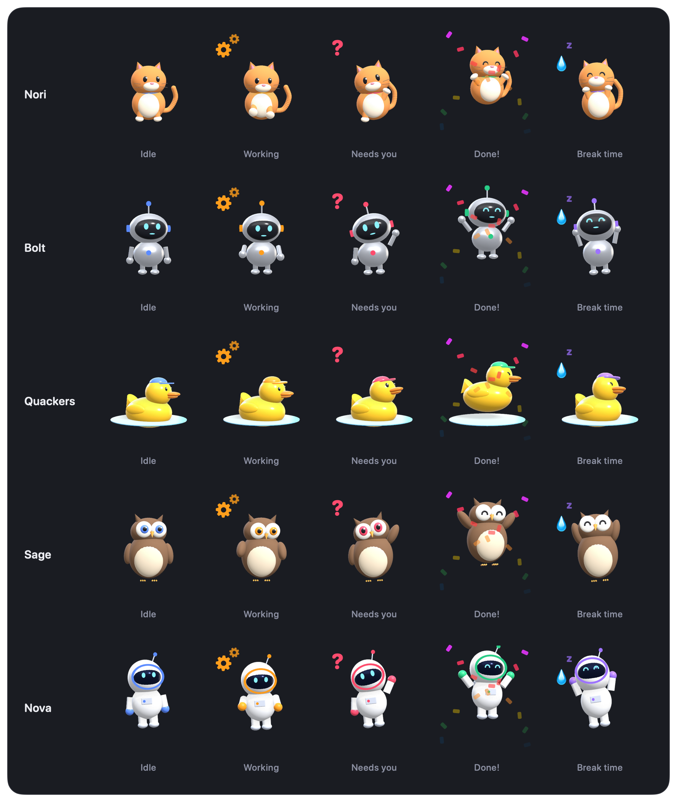</p>

It acts out your day too: it eats at lunch, drinks when it's time for water, falls asleep at night, and wears a red **PROD** band when something touches production.

<p align="center">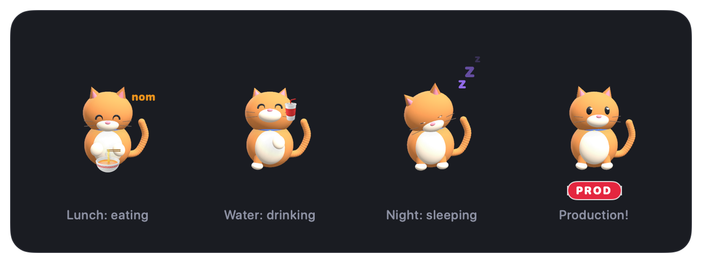</p>

### Festivals

On a festival the buddy dresses up and says hello: diyas for **Diwali**, a Santa hat and a present for **Christmas**, a party hat for **New Year**, a witch's hat and a pumpkin for **Halloween**, the flag for **Independence Day** and **Republic Day**, and clouds of color for **Holi**. Turn it off with ⚙︎ → **Festival costumes**, or add your own days (see `festivals` under [Configuration](#configuration)).

<p align="center">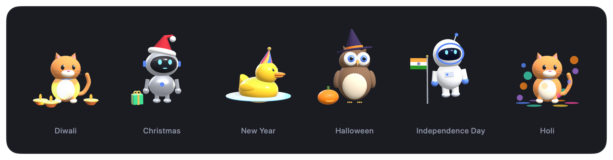</p>

---

## Install on your Mac

### Option A: download the app

1. Download **AgentBuddy-x.y.z.zip** from the [latest release](https://github.com/aswinikumar-555/agent-buddy/releases/latest) and unzip it.
2. Move **AgentBuddy.app** into your Applications folder.
3. Open it. It isn't notarized by Apple, so the first time macOS says it can't check it: open **System Settings → Privacy & Security**, scroll down, and click **Open Anyway** (or right-click the app → **Open**).
4. The buddy asks to **connect to Claude Code and Codex**. Click **Connect**: it adds its hooks, the `buddy` command and the status line, and starts at login.

Works on Apple silicon and Intel Macs with macOS 14 or later.

### Option B: build it yourself

### 1. What you need

| | |
|---|---|
| **macOS 14 (Sonoma) or later** | Apple silicon or Intel |
| **Apple's command line tools** | Builds the app on your Mac. If you don't have them, run `xcode-select --install` |
| **Claude Code and/or Codex** | The agents it watches |
| *Optional:* [`gh`](https://cli.github.com) | For GitHub pull requests and deploys. Log in with `gh auth login` |
| *Optional:* [`glab`](https://gitlab.com/gitlab-org/cli) | For GitLab merge requests and deployments. Log in with `glab auth login` |
| *Optional:* [`aws`](https://aws.amazon.com/cli/) | For the AWS login light and ECS health |
| *Optional:* [`gcloud`](https://cloud.google.com/sdk/docs/install) | For the Google Cloud login light and Cloud Run health |
| *Optional:* [`herdr`](https://herdr.dev) | To see agents in herdr panes and send them messages |

### 2. Install

```bash
git clone https://github.com/aswinikumar-555/agent-buddy.git ~/agent-buddy
cd ~/agent-buddy
bash install.sh
```

The installer:
1. Checks the requirements above.
2. Builds the app from source on your Mac (about a minute the first time). Nothing is downloaded.
3. Installs it to `~/Applications/AgentBuddy.app` and starts it at login.
4. Connects it (`AgentBuddy --setup`, the same step the downloaded app does when you click Connect):
   - adds its hooks to Claude Code (`~/.claude/settings.json`) and Codex (`~/.codex/hooks.json`). Your existing hooks are kept, and a backup is saved next to each file (`.bak-agent-buddy`);
   - sets Claude Code's status line to show your plan usage, unless you already have your own;
   - installs the `buddy` command, and adds a short note to `~/.claude/CLAUDE.md` and `~/.codex/AGENTS.md` telling agents when to use `buddy say`;
   - creates your config at `~/.agent-buddy/config.json` from `config.example.json`.

### 3. After installing

- **Restart any open Claude Code or Codex sessions** so they pick up the hooks.
- **Codex:** the next time you start Codex it asks you to **Review hooks**: choose **Trust all and continue**, or Codex won't run them. (In the Codex app: Settings → Hooks → Trust all.)
- **Edit `~/.agent-buddy/config.json`** to add your repos, sites and so on (see [Configuration](#configuration)), then restart the buddy: right-click it → ⚙︎ → Quit, then `open ~/Applications/AgentBuddy.app`.
- macOS may ask once whether Agent Buddy may **control Terminal**. That's only used when you click "jump to agent" or send a message to an agent in a Terminal tab.

To update later: `cd ~/agent-buddy && git pull && bash install.sh`.

---

## Using it

| You want to… | Do this |
|---|---|
| See everything | Click the buddy |
| Hide the panel | Click the buddy again, or **×** |
| Make the panel smaller | **⤡** in the panel header (minimize), or drag its top-left corner or edges |
| Move the buddy | Drag it |
| Make the buddy bigger or smaller | ⚙︎ → Bigger / Smaller |
| Switch character | ⚙︎ → Character |
| Add a to-do | Type it in **Me** → To-do, or run `buddy todo "Review #31"` |
| Get reminded to do it at a time | End it with a time ("… at 5pm", "… tomorrow 9am"), or click the clock next to it. Click a to-do's time to snooze or change it |
| Copy your timesheet | **Me** → Timesheet → Today or Week → Copy (pastes into a spreadsheet) |
| Join your next meeting | Click the bubble or the meeting's status pill, or **Join** in **Me** → Meetings |
| Jot something down from anywhere | **⌥Space**, type, Return (`@shop-web run the tests` sends it to that agent) |
| Turn a feature on or off | ⚙︎ → **Features** |
| Make the status area taller or shorter | **−** / **+** next to STATUS, or drag the little grip; click STATUS to collapse it |
| Open a background agent | **Open** next to it in **Agents** → Background & cloud (runs `claude attach`) |
| Light or dark panel, or another color scheme | ⚙︎ → Theme |
| Answer agents from the buddy | Turn on **Remote** in the panel header |
| Message an agent | Click the agent in the panel, type, send |
| Hold all alerts | ⚙︎ → Nap |
| Let an agent or script tell you something | `buddy say "Tests are green"` (add `--urgent` to keep it until dismissed) |

The panel has four tabs: **Agents**, **Code** (PRs, PR stats, local stack, deploys, errors), **Cloud** (sites, AWS ECS, Google Cloud Run, Codex cloud) and **Me** (meetings, to-dos, Claude plan usage, timesheet, reminders, today's summary, nap). The number tiles and status pills open the right tab.

<p align="center">
  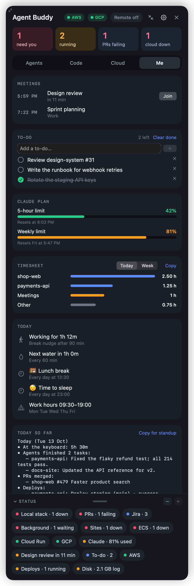
  
  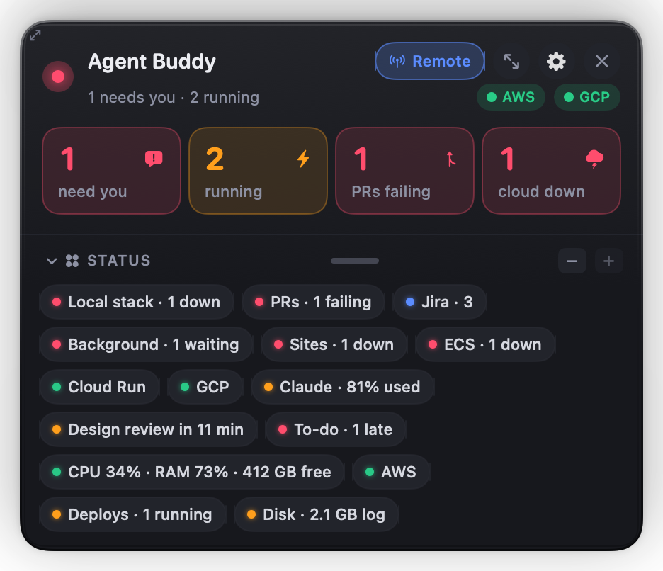
</p>
<p align="center"><sub>Left: the <b>Me</b> tab. Middle: the <b>Code</b> tab with PR stats. Right: the panel minimized to just the numbers and status.</sub></p>

**Claude plan usage** comes from Claude Code's status line: `install.sh` sets the status line to show your model and usage (for example `Opus · 5h 42% · week 18%`) and pass it on to the buddy. If you already have your own status line, it's left alone; pipe the same input into `~/.agent-buddy/buddy-hook statusline` to add it.

**Meetings** come from the macOS Calendar app, so add your work calendar there first (System Settings → Internet Accounts, e.g. Google). The first time, macOS asks to let Agent Buddy see your calendars.

### Themes

Pick a look for the panel with ⚙︎ → **Theme**: **Midnight**, **Daylight**, **Ocean** or **Sunset**, **Auto** to follow your Mac's light/dark setting, or **Apple (iOS style)**.

**Apple (iOS style)** looks like your iPhone: Apple's Liquid Glass over your desktop (on macOS 26), Control Center style tiles, Settings style colored icons, and Apple's own colors in light and dark (it follows your Mac). Its panel is **Solid** by default; for see-through glass pick ⚙︎ → **Glass**: **Clear**, **Balanced** or **Frosted**.

<p align="center">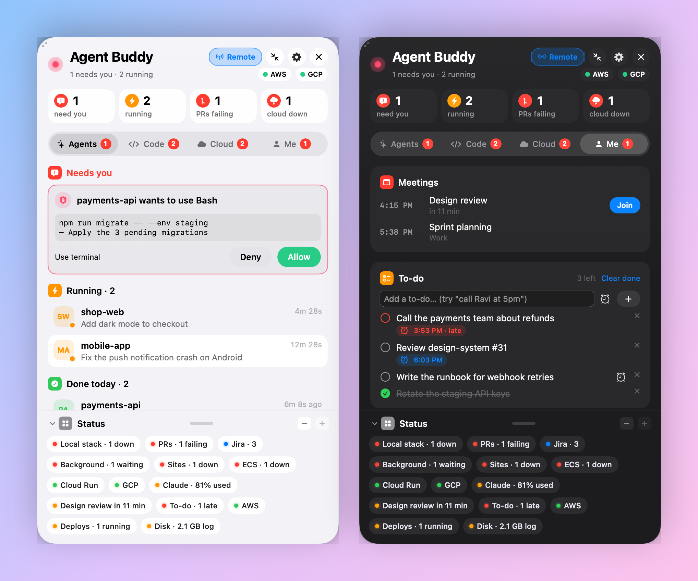</p>

<p align="center">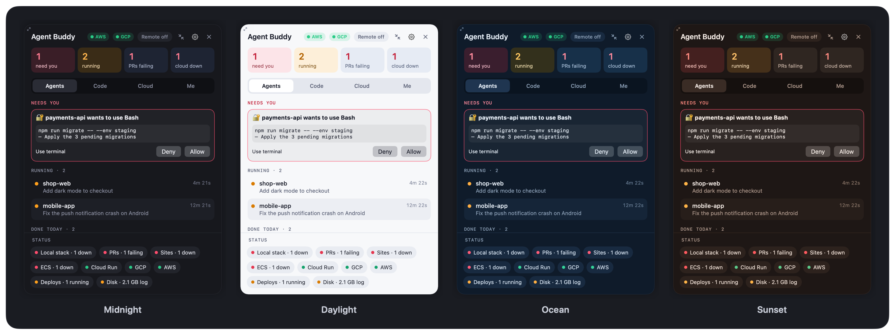</p>

---

## Configuration

Edit `~/.agent-buddy/config.json`, then restart the buddy. Every setting is optional; `config.example.json` shows them all. If the file has a mistake, the buddy says so in its bubble and runs on defaults (your file is never overwritten).

| Setting | What it does | Default |
|---|---|---|
| `repos` | GitHub repos (`owner/name`) watched for deploys, your PRs, PR stats and `claude/` branches | none |
| `deployWorkflowPattern` | Which GitHub Actions workflows count as deploys (regex) | `deploy\|promote\|rollback\|release` |
| `workHours` | `start`, `end`, `days`. Outside them, work alerts are quiet | 09:30–20:00, Mon–Sat |
| `breakMinutes` / `waterMinutes` | Break and water reminder intervals | 90 / 60 |
| `dailyReminders` | Fixed-time reminders: `time`, `title`, `message`, `emoji`, and `activity` (`eat`, `drink` or `sleep`) for the buddy to act out | lunch 14:00, sleep 23:00 |
| `stuckWaitingMinutes` / `stuckQuietMinutes` | When an agent counts as waiting too long / stuck | 10 / 20 |
| `juggle` | Agents at once before it suggests finishing one | 5 |
| `autoRemote` / `autoRemoteMinutes` | Remote mode on after being away this long | on / 5 |
| `stackRoots` | Folders holding your projects (scanned for dev stacks, big logs, old worktrees) | `~/Developer`, `~/code`, `~/projects` |
| `dbTunnels` | Local database tunnel ports to watch: `{ "env": "prod", "port": 5439 }` | none |
| `ecsRegion` / `ecsClusters` | AWS ECS clusters to watch (read-only) | none |
| `gcpProjects` | Google Cloud projects whose Cloud Run services to watch (read-only): `{ "project": "my-proj", "region": "us-central1" }` (leave out `region` for all regions) | none |
| `sites` | Health checks: `{ "name", "url", "prod" }`. Any 2xx/3xx answer counts as up | none |
| `prodEnvs` | Names that mean production (in cluster names, tunnels, stack envs) | `prod`, `production` |
| `prodPatterns` | Regexes for shell commands that touch production (secret names, prod hosts, …) | a few generic ones |
| `features` | Turn features on or off by default, e.g. `{ "jira": false, "walking": true }`. Names: `stuckAlerts`, `autoRemote`, `juggling`, `claudeUsage`, `backgroundAgents`, `cloudBranches`, `pullRequests`, `prStats`, `deploys`, `devStack`, `logErrors`, `housekeeping`, `jira`, `sites`, `aws`, `ecs`, `gcp`, `codexCloud`, `prodWarning`, `water`, `breaks`, `dailyReminders`, `endOfDay`, `meetings`, `todos`, `timesheet`, `festivals`, `quickCapture`, `idleTricks`, `eyesFollow`, `walking`. A switch you flip in ⚙︎ → Features wins | all on except `walking` |
| `gitlab` | GitLab projects to watch, like `repos` for GitHub: `{ "projects": ["group/project"], "host": "gitlab.example.com" }` (leave out `host` for gitlab.com) | none |
| `jira` | `{ "site": "yourteam.atlassian.net", "email": "you@example.com" }`, plus optional `jql` (default: your open tickets). See [Jira](#jira) for the token | none |
| `meetings` / `meetingHeadsUpMinutes` | Meeting heads-up from the Calendar app, and how many minutes before | on / 5 |
| `festivals` | Your own special days: `{ "date": "06-12", "name": "My birthday", "greeting": "🎂 Happy birthday!", "costume": "partyHat" }`. `date` is `MM-dd` (every year) or `yyyy-MM-dd`; `costume` is `partyHat`, `santaHat`, `witchHat`, `diya`, `holi` or `flag`; add `"days": 2` for longer ones | built-in festivals |

### Jira

Agent Buddy reads Jira with an API token, kept in your Mac's Keychain (never in the config file):

1. Create a token at <https://id.atlassian.com/manage-profile/security/api-tokens>.
2. Save it in the Keychain (use the same email as in the config):
   ```bash
   security add-generic-password -s agent-buddy-jira -a you@example.com -w
   ```
   (it asks for the token, so it doesn't end up in your shell history)
3. Add `"jira": { "site": "yourteam.atlassian.net", "email": "you@example.com" }` to the config and restart the buddy.

### The local dev stack monitor

This watches projects that start their services with a `scripts/dev/ports.sh` port map, PID files in `.dev-pids/` and logs in `.dev-logs/` (the convention it was built for). Projects that don't use that layout are simply skipped.

---

## Privacy and what it touches

- **Local only.** No server and no telemetry. Its data lives in `~/.agent-buddy/` (events, settings, notes, to-dos, daily summaries and timesheets). Your calendar is read on your Mac and never leaves it.
- **Network calls happen only through tools you already use and only for features you configure:** `gh` (PRs, deploys, PR stats, `claude/` branches), `glab` (the same for GitLab), Jira's REST API (your tickets, with your token from the Keychain), `aws` (read-only: `sts get-caller-identity`, ECS describe and list calls), `gcloud` (read-only: `auth print-access-token`, `run services list`), `codex cloud list`, and plain GET requests to the `sites` you list.
- **It never deploys, scales, deletes or changes anything** in your cloud accounts or repos. The production warning only warns.
- Files it changes outside its own folder: `~/.claude/settings.json` (hooks, and the status line if you don't have one), `~/.codex/hooks.json`, `~/.claude/CLAUDE.md`, `~/.codex/AGENTS.md` (a marked section), the `buddy` command in `/opt/homebrew/bin` (or `~/.local/bin`), and a login item in `~/Library/LaunchAgents`. The uninstaller removes all of them.

---

## Uninstall

If you built it yourself:

```bash
cd ~/agent-buddy && bash uninstall.sh
```

If you downloaded the app: quit it (⚙︎ → Quit), then run this and drag the app to the Trash:

```bash
/Applications/AgentBuddy.app/Contents/MacOS/AgentBuddy --uninstall && rm -rf ~/.agent-buddy
```

Either way this removes its hooks and status line, the `buddy` command, the `CLAUDE.md` / `AGENTS.md` section, its login item, and `~/.agent-buddy/`.

---

## Troubleshooting

| Problem | Fix |
|---|---|
| `xcrun: error` or `swiftc` not found during install | Run `xcode-select --install`, then `bash install.sh` again |
| The buddy doesn't appear | `open ~/Applications/AgentBuddy.app`. If it's off-screen after unplugging a display, it moves back on its own at the next start |
| Agents don't show up | Restart the agent sessions after installing. For Codex, trust the hooks (Settings → Hooks → Trust all) |
| No PRs or deploys | Install `gh` (or `glab` for GitLab), log in (`gh auth login` / `glab auth login`), and list your repos in `repos` (or `gitlab.projects`) |
| Downloaded app won't open | It isn't notarized: System Settings → Privacy & Security → **Open Anyway** |
| Jira says "not connected" | Check the token is in the Keychain under `agent-buddy-jira` with the same email as the config (see [Jira](#jira)) |
| AWS light is grey | `aws` isn't installed or you're offline. Red means run `aws login` (or click the light) |
| GCP light is red | Your `gcloud` login expired: click it to run `gcloud auth login` |
| Settings didn't change | Restart the buddy after editing the config. A bubble at start-up tells you if the file has an error |

---

## Building by hand

```bash
bash scripts/build-app.sh          # → build/AgentBuddy.app, for this Mac
bash scripts/release.sh            # → dist/AgentBuddy-<version>.zip, Apple silicon + Intel
```

Every push and pull request is built on a Mac by GitHub Actions ([`.github/workflows/build.yml`](.github/workflows/build.yml)), so a change that doesn't compile shows a red ✗ before it's merged.

The images in this README are drawn by the app itself from made-up sample data, so they always match the real UI. To redraw them after a change:

```bash
./build/AgentBuddy --render-docs docs
```

- `Sources/App/` is the app (SwiftUI + SceneKit): `main.swift` (tracking and the buddy), `Panel.swift` (the panel), `Buddy3D.swift` (the 3D characters), plus one file per feature area.
- `Sources/Hook/main.swift` is the small program Claude Code and Codex run for each hook event. It appends one line to `~/.agent-buddy/events.jsonl`, and in Remote mode waits for your answer from the app.

## Contributing

Ideas, bug reports and pull requests are welcome.

- **Suggest a feature:** [open a feature request](https://github.com/aswinikumar-555/agent-buddy/issues/new?template=feature_request.md)
- **Report a bug:** [open a bug report](https://github.com/aswinikumar-555/agent-buddy/issues/new?template=bug_report.md)
- **Send code:** see [CONTRIBUTING.md](CONTRIBUTING.md) for setup, where things are, and house rules.

## Credits

Built with [Claude Code](https://claude.com/claude-code).

## License

[MIT](LICENSE)
